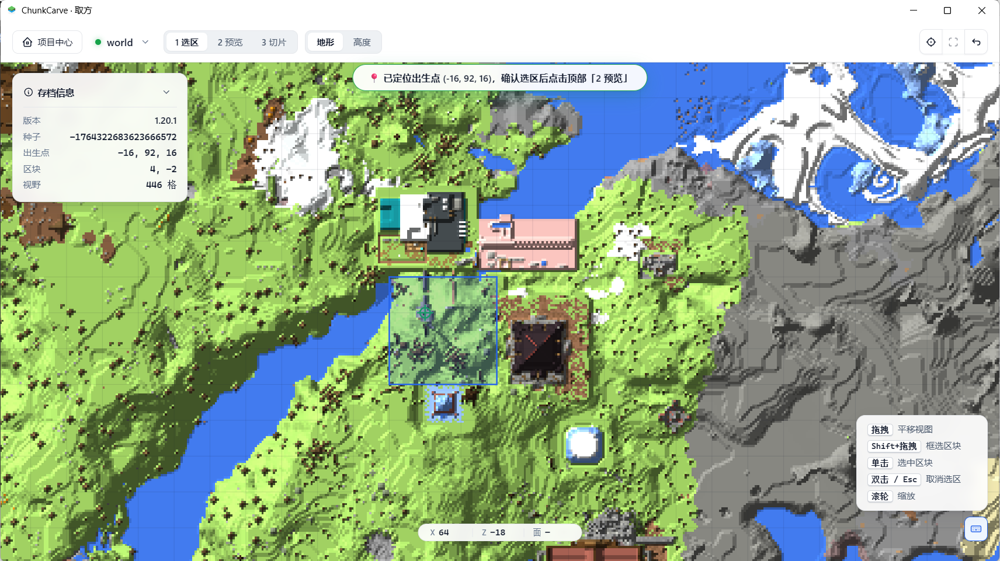
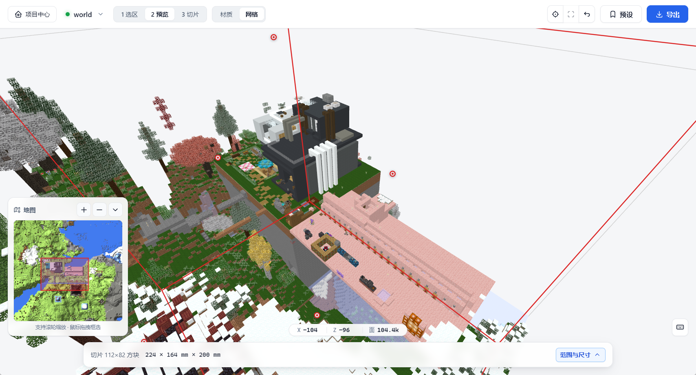
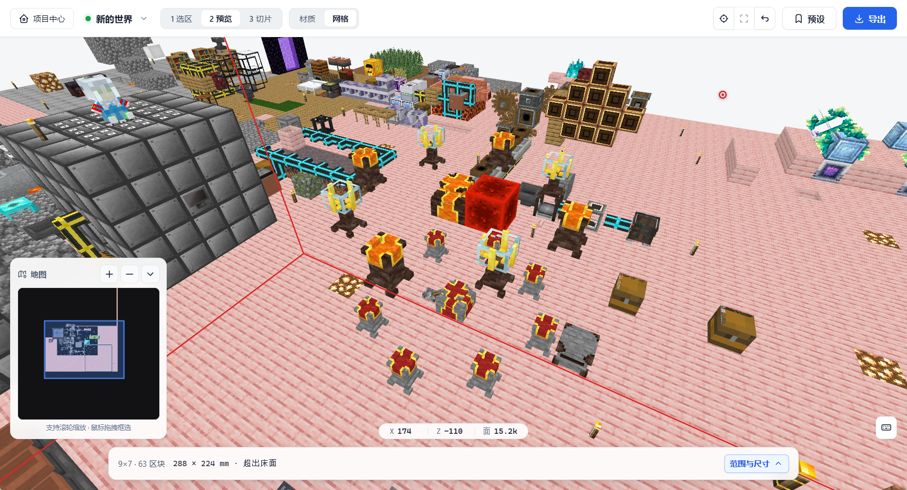
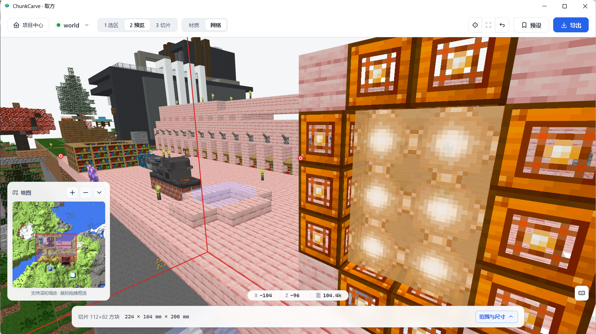
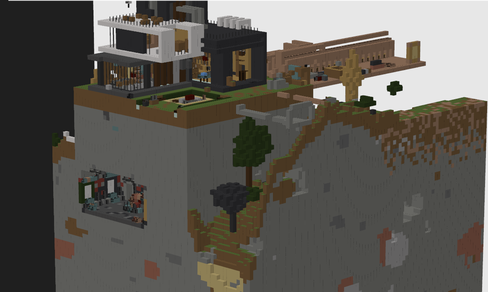
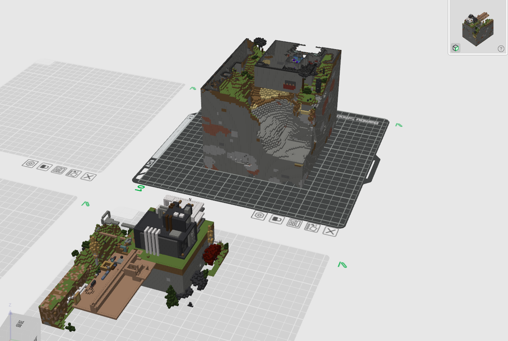
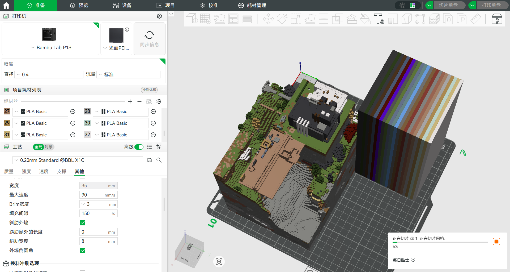
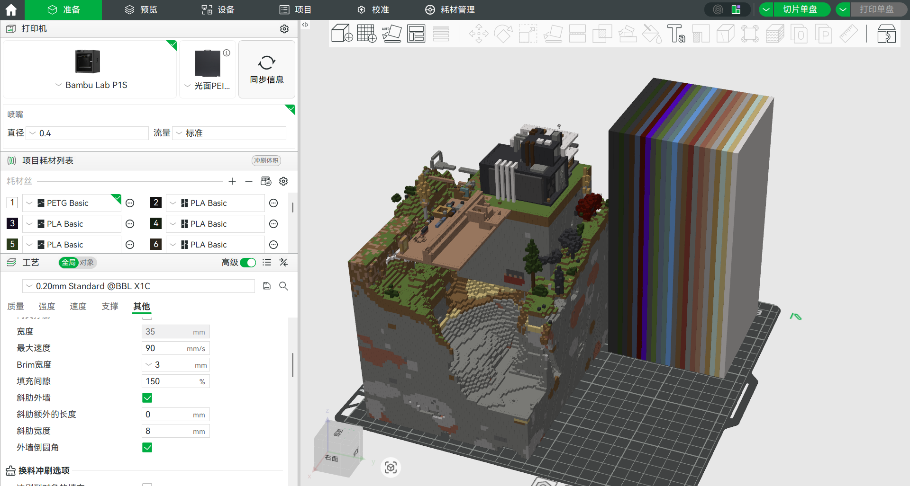

# ChunkCarve（取方）

[](https://github.com/Cangminghai/chunkcarve/actions/workflows/ci.yml)
[](https://github.com/Cangminghai/chunkcarve/releases)
[](https://github.com/Cangminghai/chunkcarve/discussions)
[](LICENSE)
[](https://www.python.org/downloads/)
[](#安装与启动)

> “鼎，取新也。”——《易·杂卦》
> “尝一脔肉，而知一镬之味、一鼎之调。”——《吕氏春秋·察今》

**三千方块，取其一方。**<br>
*Carve one chunk out of the world.*

ChunkCarve（取方）是一个面向 Minecraft Java 版世界存档的开源观察与 3D 打印建模工具。它直接从你本机的游戏存档中读取地形、建筑、原版与模组方块状态，先在 2D 俯视地图中精准定位与框选范围，再通过 2.5D/3D 视图检查细节，并一键导出针对多色 3D 打印深度优化的 `GLB`、`OBJ`、`3MF` 或 `STL` 模型文件。

当前版本为 **v1.0.3**，聚焦打磨最核心的两步工作流：**1 选区** 与 **2 预览（含导出）**。界面中的「3 切片」入口目前保留为试验阶段提示。

- 📦 **Windows 免安装版下载**：前往 [GitHub Releases](https://github.com/Cangminghai/chunkcarve/releases) 下载最新 `ChunkCarve-v1.0.3-win64.zip`，解压双击 `ChunkCarve.exe` 即可使用。
- 💬 **常见问答与交流反馈**：遇到导入设置或打印问题？请查阅 [`docs/faq.md`](docs/faq.md) 或前往 [GitHub Discussions 常见 Q&A 指南帖](https://github.com/Cangminghai/chunkcarve/discussions/2)。

---

## 快速预览

### 地图选区与立体预览

<table>
  <tr>
    <td width="50%"></td>
    <td width="50%"></td>
  </tr>
  <tr>
    <td align="center">地图浏览、出生点/玩家定位和蓝框选区</td>
    <td align="center">选区进入 2.5D/3D 立体预览</td>
  </tr>
  <tr>
    <td width="50%"></td>
    <td width="50%"></td>
  </tr>
  <tr>
    <td align="center">整合包方块、建筑和地形细节</td>
    <td align="center">近距离检查模型表面、非完整方块和装饰</td>
  </tr>
</table>

### 模型与多色 3D 打印工作流示例

<table>
  <tr>
    <td width="50%"></td>
    <td width="50%"></td>
  </tr>
  <tr>
    <td align="center">导出的体素模型效果</td>
    <td align="center">多模型工作区示例</td>
  </tr>
  <tr>
    <td width="50%"></td>
    <td width="50%"></td>
  </tr>
  <tr>
    <td align="center">在切片软件中检查多色模型</td>
    <td align="center">切片和耗材配置示例</td>
  </tr>
</table>

---

## 核心特性（v1.0.3）

- **地图选区与玩家快捷定位**：
  - 支持地形/高度双图层浏览、`Shift + 左键拖拽` 框选区块。
  - **底部快捷定位栏**：自动解析单人/多人存档中所有玩家的真实坐标与角色昵称（读取 `level.dat`、`playerdata/*.dat` 及 `usercache.json` / `usernamecache.json`）。当你的基地离世界出生点相隔数千格甚至数万格时，直接在底栏下拉选择玩家昵称或输入任意 `X / Z` 坐标，即可一键「跳转」或「定位并框选 3×3 区块」。
- **1:1 真实比例 2.5D/3D 预览与导出**：
  - 原生解析原版及 Forge / Fabric 整合包方块状态（BlockState）与模型贴图。
  - **非完整方块精准还原**：树叶作为完整方块处理；雪片（多层雪）、楼梯、台阶、讲台、活板门、砂轮、栅栏、花盆等非完整方块严格按 `1:1` 物理比例与原位偏移生成，不会出现缩角或比例失真。
  - **交叉面与贴图装饰独立开关**：草丛、花卉、火把等交叉贴图装饰默认生成带打印厚度的轮廓实体；若只需纯净建筑与地形主体，可在导出菜单一键取消勾选。
- **专为多色切片打造的高精度网格引擎**：
  - **像素级微网格细分（`标准` / `8×8` / `16×16`）**：在导出 `GLB` / `OBJ` 时可将每个方块面正交双线性细分为 `8×8` 或 `16×16` 像素微网格，彻底消灭切片软件按顶点赋予颜色时产生的“半白半原色”对角线斜切三角形锯齿。
  - **水密顶点焊接与退化面清理**：自动剔除零面积退化三角形、消除 IEEE-754 `-0.0` 符号位差异导致的网格未焊接裂缝，避免跨整个选区的辐射状破面。
- **项目中心多整合包管理**：支持直接选择 `.minecraft`、`versions` 根目录或独立实例目录（PCL / HMCL / 官方启动器），自动枚举全部整合包实例与存档并记忆项目配置。

---

## ⚠️ 切片软件导入与导出必看注意事项（避坑指南）

将导出的 `GLB` 或 `OBJ` 拖入 **Bambu Studio**、**OrcaSlicer** 或 **创想云（Creality Print）** 进行多色打印时，请务必注意以下三点：

### 1. 导入弹窗中务必把「光滑程度 / 平滑度」调为 `0`！
当切片软件弹出「导入模型 / 转换多色纹理」窗口时，软件默认的「光滑程度（Smoothness）」通常为 `10`（或较高数值）：
- **现象**：如果不改，切片软件会对不同颜色的交界线做拉普拉斯曲线平滑，导致原本横平竖直的 Minecraft 方块分界线（如草地与泥土交界、矿物边缘）变成**连续弯曲的波浪弧线**！
- **正确做法**：在导入窗口右上角将 **「光滑程度 / 平滑度」改为 `0`**（或允许的最小值），点击 **「应用」** 刷新预览，确认方块边界恢复笔直直角后，再点击「确定」完成导入。

### 2. 方块表面出现“一半白/一半原色”三角形锯齿？请开启微网格细分
切片软件将贴图转为多色打印体时，是**按三角面片或顶点采样贴图颜色**，而不是在单个大三角形内部切分贴图像素。在默认的「标准（2 三角形/面）」下，如果一张方块贴图（如覆雪草方块侧面、矿石、工作台）同时包含深浅两种颜色，对角线就会把方块面斜切成两个纯色大三角形。
- **日常推荐：`8×8 微网格（防斜切锯齿·推荐）`** —— 每个面细分为 64 个小格（128 个三角形），耗时仅数秒至十几秒，即可消除绝大多数斜切锯齿，兼顾画质与文件体积。
- **极致还原：`16×16 像素级（极致平整·耗时较久）`** —— 严格对应原版 `16×16` 像素格（每个像素格独立顶点与几何面），100% 还原每一个像素方块边缘。

### 3. ⏳ 关于导出 `16×16` 细分模型的等待时间特别提醒
> **重要提示**：开启 `16×16 像素级` 细分后，模型的三角面片数量会直接放大 **256 倍**（例如原本 5 万面的选区会变为约 **1,280 万面**）！
> - **正常耗时**：小型选区（1~4 区块）约需数秒至十余秒；中等或较大选区（9~36+ 区块）后台执行微网格剖分、顶点去重焊接与二进制封装通常需要 **数十秒至数分钟**，导出的 `.glb` / `.zip` 体积也会达到数十 MB 至上百 MB，且拖入切片软件后的多色解析同样会变慢。
> - **请勿中途刷新**：导出期间界面顶部会实时显示 `（已耗时 Xs）` 计时。**这属于正常的高密度几何计算，并非程序卡死**，请耐心等待直至弹出文件保存窗口，切勿刷新或关闭程序。
> - **提速建议**：如果选区较大且不想久等，建议：① 优先改用 **`8×8 微网格`**（面数仅为 16×16 的 1/4，速度快约 4 倍）；② 在底栏适当调高 `Y 高度` 底界（裁掉不需要的地下深层岩石）；③ 若无需花草火把，取消勾选「交叉面／贴图装饰」。

---

## 安装与启动

### 方式一：Windows 绿色免安装版（推荐普通玩家）

1. 前往 [Releases 页面](https://github.com/Cangminghai/chunkcarve/releases) 下载 `ChunkCarve-v1.0.3-win64.zip`。
2. 右键下载的 ZIP 压缩包 → **「属性」**。如果底部有 **「解除锁定」**，勾选并点击 **「应用」** 后再解压；没有该选项则直接继续。
3. 解压到任意英文或中文路径文件夹（请保持文件夹内 `_internal` 等文件完整，不要单独把 `ChunkCarve.exe` 拖出文件夹）。
4. 双击 `ChunkCarve.exe` 即可启动桌面窗口（需要 Windows 10/11 自带的 Edge WebView2 运行时）。

如果启动时提示 `Failed to resolve Python.Runtime.Loader.Initialize`，请按 [FAQ 的 Windows 启动排查](docs/faq.md#q10windows-双击无法启动或浏览器访问失败如何排查) 解除下载文件的锁定后重试。

### 方式二：从源码运行（跨平台 / 开发者）

环境要求：
- Python 3.11 或更高版本
- Windows、Linux 或 macOS
- 本机装有 Minecraft Java 版客户端与存档（包含 `level.dat`，地形位于旧版的 `region/` 或 26.1+ 的 `dimensions/minecraft/overworld/region/`）

```powershell
git clone https://github.com/Cangminghai/chunkcarve.git
cd chunkcarve
py -m venv .venv
.\.venv\Scripts\python.exe -m pip install -r requirements.txt
```

- **Windows 桌面模式**：直接双击根目录 `启动.bat`，或执行 `.\.venv\Scripts\pythonw.exe desktop.pyw`。
- **浏览器服务模式（Windows / Linux / macOS 通用）**：
  ```powershell
  .\.venv\Scripts\python.exe -m mcmap.server
  ```
  终端提示就绪后，用现代浏览器打开 <http://127.0.0.1:8770/>。

---

## 详细使用流程

### 第 1 步：在项目中心绑定整合包与存档
1. 打开软件进入「项目中心」，点击右上角 **「新建项目」**（也可直接点击右侧自动扫描到的 PCL / HMCL / 官方启动器实例一键创建）。
2. 点击浏览选择你的 `.minecraft` 目录、`versions` 目录或具体整合包文件夹。
3. 若所选目录下包含多个游戏实例，请从「检测到的版本实例」下拉框中选择你要渲染的具体整合包（例如 `元素觉醒1.4.6`），等待下方状态胶囊更新出正确的版本 Jar、模组数与材质包数。
4. 在存档列表中点选目标存档，点击 **「保存并开始渲染重生点」**。

### 第 2 步：地图浏览、玩家定位与精确选区
1. **快速找家（底栏定位）**：如果出生点一片荒野、你的建筑在很远的地方，直接点击底栏左侧 **「定位」下拉框**，选择你的玩家名（格式如 `👤 玩家名 (-1240, 860)`），点击 **「定位并框选」** 即可瞬间飞到玩家所在位置并自动框选周围 3×3 区块；也可以手动输入游戏内按 `F3` 看到的 `X / Z` 坐标跳转。
2. **自由框选区块**：在地图上按住鼠标左键拖动平移视野，滚轮缩放，按住 **`Shift + 左键拖拽`** 框选目标区块（单次体素化导出上限为 **64 个区块**，例如 `8×8` 区块）。
3. **方块级微调与比例设置**：点击底栏右侧 **「范围与尺寸」** 展开详细面板：
   - **Y 高度**：默认自动探测地表与建筑高度区间；若不希望打印厚重的地下深层石头，可手动上调底界 `Y` 值。
   - **X / Z 范围**：支持精确到单格方块的裁切边界。
   - **比例（mm/格）**：设置每个 Minecraft 方块对应的现实毫米边长（默认 `2 mm/格`，即 1 个区块 16 格对应 `32 mm`）。

### 第 3 步：2.5D/3D 预览检查与导出
1. 点击底栏 **「2 预览 →」**（或顶部导航栏 `2 预览`）进入立体视图：
   - **左键拖拽**：旋转视角；**右键/中键拖拽**：平移视角；**滚轮**：缩放；按 **`R` 键**：一键复位视角；按 **`G` 键**：切换网格线叠加。
   - 在立体视图中按住 **`Shift + 左键拖拽`** 同样可以直接屏幕框选裁剪子区域。
2. 点击右上角 **「导出」** 按钮展开导出设置：
   - **格式**：多色贴图导入切片软件首选 `GLB · 内嵌贴图（默认）`；需要单独编辑贴图选 `OBJ`；无贴图快速分色选 `3MF`；单色白模选 `STL`。
   - **网格细分**：多色打印推荐选择 **`8×8 微网格`**；追求极致像素锐度且选区不大时可选 **`16×16 像素级`**（注意耐心等待生成）。
   - **交叉面／贴图装饰**：按需保留或关闭花草、火把等薄片装饰。
3. 点击 **「导出模型」**，等待后台生成完毕后选择保存路径即可。

更多图文步骤请参阅 [`docs/usage.md`](docs/usage.md)，导出格式与细分规格对比请参阅 [`docs/export-formats.md`](docs/export-formats.md)。

---

## 常见问答（Q&A 速查）

| 现象 / 疑问 | 原因简析 | 解决方案 |
|---|---|---|
| **导入切片软件后，方块颜色分界线变成了弯曲波浪线？** | 切片软件多色转换默认开启了边界曲线平滑（如光滑程度=10） | 导入弹窗中将 **「光滑程度 / 平滑度」调为 `0`** 并点击「应用」 |
| **草方块侧面、矿石表面出现“一半白一半原色”斜切三角形锯齿？** | 标准网格每面仅 2 个三角形，切片软件按顶点采样贴图时沿对角线一刀切 | 导出菜单将「网格细分」改为 **`8×8 微网格`**（推荐）或 **`16×16 像素级`** |
| **选了 `16×16` 细分点击导出后等了很久还没弹窗？** | `16×16` 会将面数放大 **256 倍**，大选区可达上千万面，计算与压缩耗时较长 | 观察顶部 `已耗时 Xs` 耐心等待，切勿刷新；若嫌慢请改选 **`8×8 微网格`** 或调高底界 `Y` |
| **打开存档后出生点什么都没有，找不到自己建的家？** | 基地建在远离世界默认出生点的位置 | 使用底栏左侧 **「定位」** 下拉框选择你的玩家角色坐标，或直接填入 X/Z 坐标跳转 |
| **树叶、雪片、讲台、活板门、砂轮导出后是什么形态？** | 树叶按完整不透明方块导出以便可靠打印；其余非完整方块按模型元素提取 | v1.0.3 已修复所有非完整方块 1:1 比例与位置偏移，雪片等薄层均完整铺满对应格位 |
| **提示颜色超过 64 个耗材或颜色槽位太多？** | 整合包贴图颜色丰富，超出切片软件单盘耗材上限 | 在切片软件导入弹窗调小「颜色数目」（如 8/16 色）并勾选「自动合并相同的耗材」 |

完整版 10 大常见问题排查与图文细节请查看 **[`docs/faq.md`](docs/faq.md)** 或访问 **[GitHub Discussions](https://github.com/Cangminghai/chunkcarve/discussions)**。

---

## 开发、测试与打包

```powershell
# 安装开发测试依赖
py -m pip install -r requirements-dev.txt

# 运行全部单元测试
py -m pytest -q

# 构建 Windows 独立可执行程序与免安装压缩包
powershell -ExecutionPolicy Bypass -File scripts/build.ps1 -Version v1.0.3
```

前端语法检查与贡献指南见 [`CONTRIBUTING.md`](CONTRIBUTING.md)。每次推送将由 GitHub Actions 自动执行多版本 Python 测试、前端 JS 语法校验与 PyInstaller 打包检查。

## 项目边界与许可证

ChunkCarve 不包含、不内置、亦不重新分发任何 Minecraft 官方贴图、模型、声音或存档数据；所有方块资源均在用户本机运行时从用户已安装的客户端目录动态读取。Minecraft 是 Mojang Studios / Microsoft 的商标；ChunkCarve 与 Mojang Studios 或 Microsoft 无任何官方关联。

本项目源码基于 [MIT License](LICENSE) 开源，第三方依赖许可声明详见 [`THIRD_PARTY_LICENSES.md`](THIRD_PARTY_LICENSES.md)。安全漏洞反馈请遵循 [`SECURITY.md`](SECURITY.md)。
