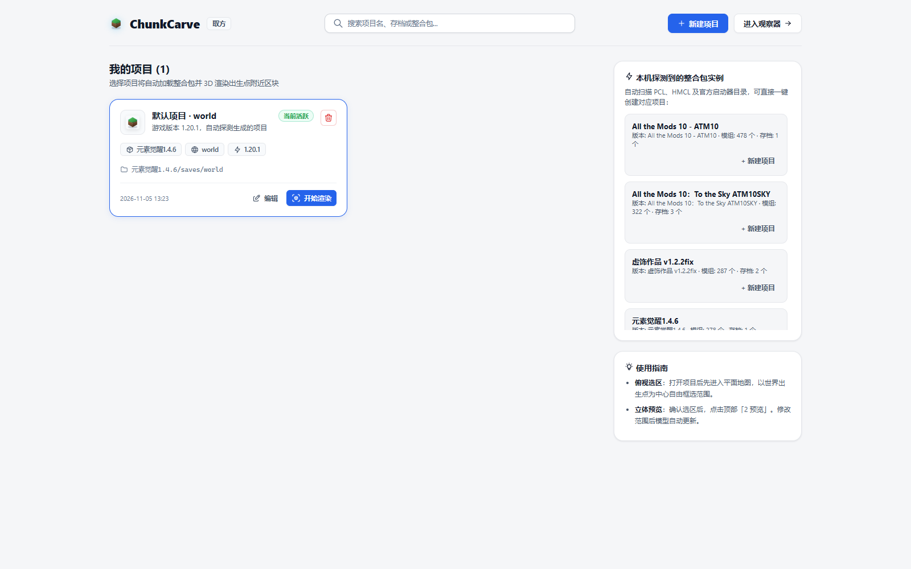
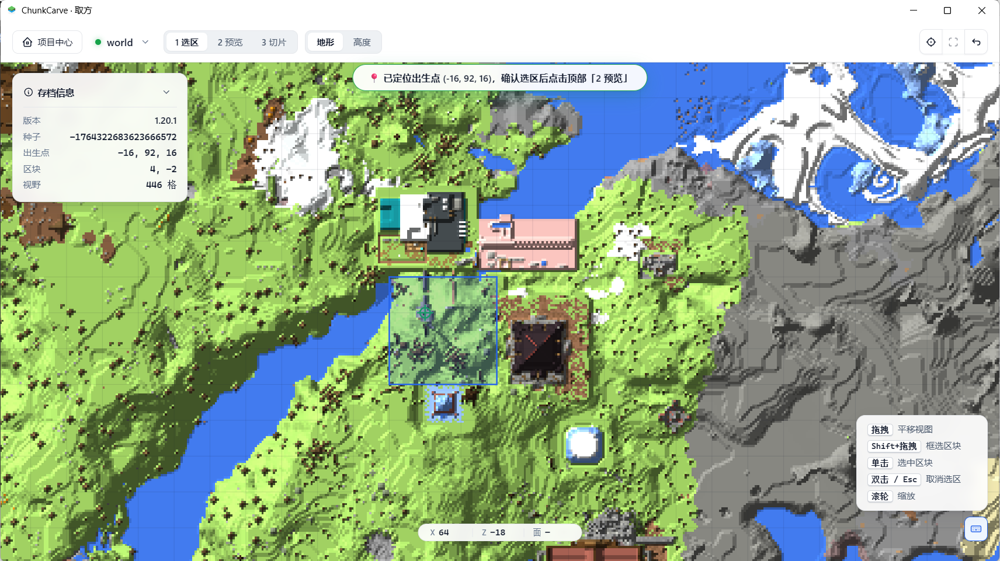
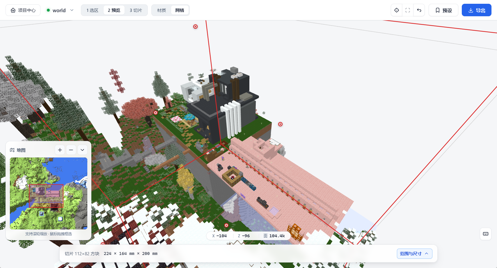
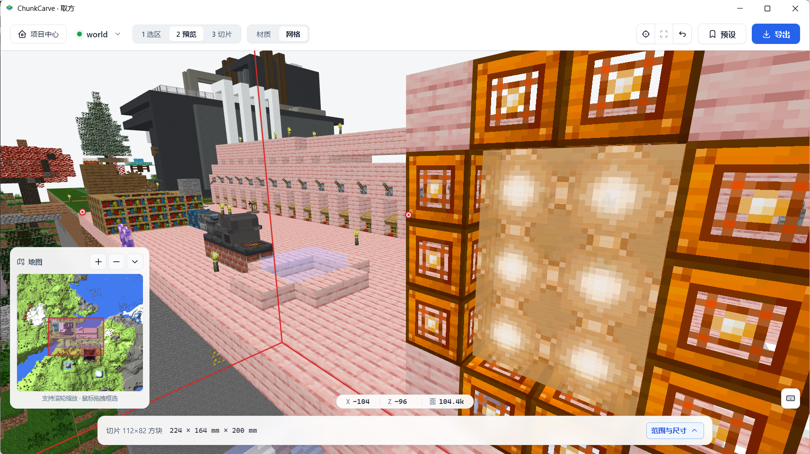
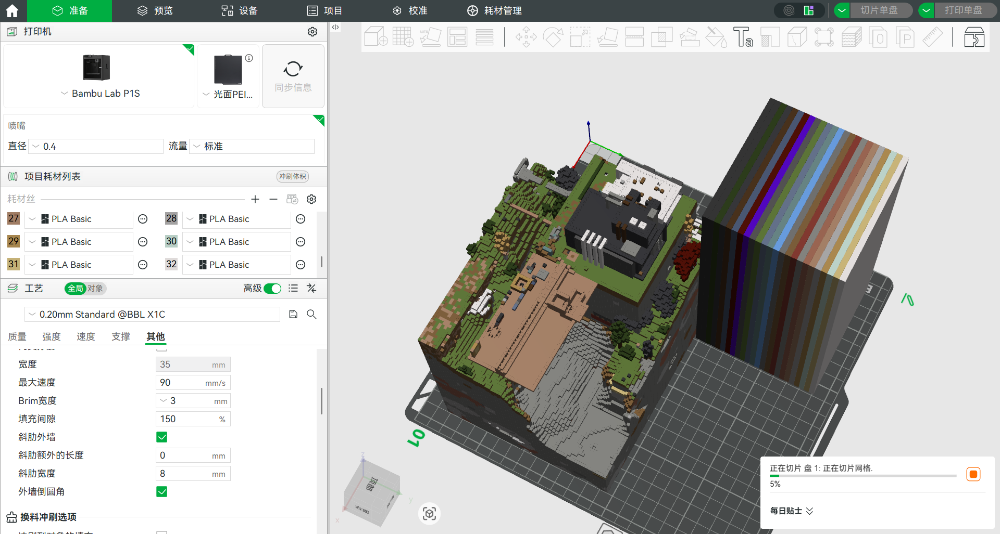
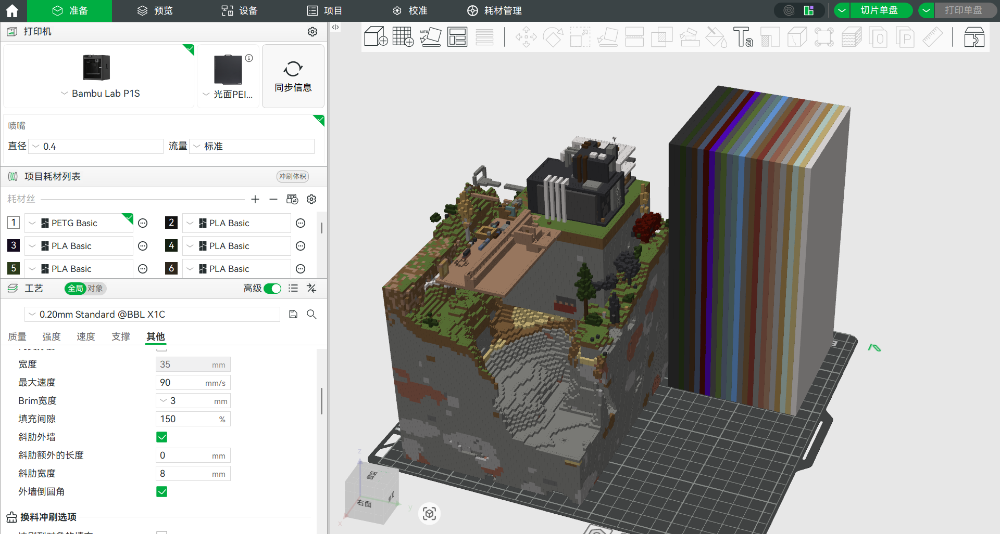

# ChunkCarve（取方）详细使用说明

本文档以 **ChunkCarve v1.0.3** 实际界面与工作流为准，完整介绍从绑定整合包、定位选区、检查 3D 细节，到导出模型并导入切片软件进行多色 3D 打印的每一步操作与注意事项。

---

## 1. 在项目中心绑定整合包与存档

启动程序后首先进入「项目中心」。你可以在右侧「本机探测到的整合包实例」列表中一键创建项目，也可以点击右上角 **「新建项目」** 手动指定目录。

### 选择目录的三种方式
1. **直接选择具体整合包实例目录**（如 `.minecraft/versions/元素觉醒1.4.6`）：程序直接读取该实例下的原版核心 Jar、`mods/`、`resourcepacks/` 与 `saves/`。
2. **选择 `versions` 根目录**（如 `.minecraft/versions`）：程序会自动扫描并列出该目录下所有可用实例。请先在 **「检测到的版本实例」** 下拉框中点选目标整合包，等待下方胶囊状态更新出正确的版本、模组数量与存档列表。
3. **选择标准 `.minecraft` 根目录**：适用于未开启版本隔离的官方启动器或传统整合包结构。

> **提示**：如果某个特殊整合包的原版渲染核心 Jar 不在常规目录，可展开向导底部的「高级选项」手动指定原版版本 Jar 路径与 `mods/` 目录。

确认存档列表加载无误后，点选你要打开的存档卡片，点击 **「保存并开始渲染重生点」**。

---

## 2. 地图浏览、快速找家与选区裁剪

进入 **「1 选区」** 后，主画布展示 2D 俯视地图（可在顶部切换「地形」与「高度」图层），左侧面板展示存档版本、世界种子与默认出生点坐标。

### 2.1 玩家远离出生点时如何快速定位？
很多生存存档或多人服务器存档中，玩家的基地与默认出生点相距数千甚至数万格。ChunkCarve v1.0.3 在底部工作栏左侧内置了 **「定位」快捷导航栏**：
- **选择玩家位置**：程序会自动扫描存档 `level.dat` 与 `playerdata/*.dat`，并向上查找整合包目录中的 `usercache.json` / `usernamecache.json` 匹配玩家昵称。点击下拉框即可看到所有玩家及其精确 `(X, Z)` 坐标；同时在 2D 地图上也会绘制橙色玩家圆点与昵称标签。
- **自定义坐标输入**：你也可以在 `X`、`Z` 输入框中直接填入游戏内按 `F3` 查看到的建筑坐标。
- **「跳转」 vs 「定位并框选」**：
  - 点击 **「跳转」**：将地图视野平滑移至目标坐标中心。
  - 点击 **「定位并框选」**：平移视野的同时，自动以该坐标为中心框选 `3×3` 区块（48×48 格），可直接点右侧 **「2 预览 →」** 立即查看立体效果。

### 2.2 框选区块与精确调整范围
- **框选区块**：按住 **`Shift + 鼠标左键拖拽`** 在地图上拉出蓝色选区框；双击空白处可清除选区。
  - *注：为保障实时体素化与导出性能，单次选区最大支持 **64 个区块**（如 `8×8` 或 `4×16` 区块）。*
- **展开「范围与尺寸」微调**：点击底栏右侧的 **「范围与尺寸」** 按钮可展开三列精确控制面板：
  - **Y 高度范围**：默认留空为「自动」，程序会自动探测选区内的最低有效地形与最高建筑顶部。如果你想减薄底座、节省耗材和缩短导出时间，可以手动上调左侧最低 `Y` 值（例如从 `50` 设为 `62`）。
  - **X / Z 方块范围**：支持突破整区块（16×16）限制，精确到单格方块裁剪模型边缘。
  - **比例（mm/格）**：控制每个 Minecraft 方块在导出模型中的毫米尺寸。默认 `2 mm/格`（即 1 格 = 2mm × 2mm × 2mm）。

---

## 3. 2.5D / 3D 立体预览与细节检查

完成选区后，点击底栏 **「2 预览 →」** 或顶栏 **「2 预览」** 进入立体观察工作区。

### 视角与显示控制
- **旋转视角**：鼠标左键拖拽
- **平移视野**：鼠标右键或中键拖拽
- **缩放距离**：鼠标滚轮
- **复位视角**：点击顶栏复位图标或按键盘 **`R`** 键（视角拖偏找不到模型时一键找回）
- **材质 / 网格切换**：顶栏可切换「材质」或「网格」（快捷键 **`G`**），方便看清每一格方块的对齐关系
- **立体框选裁剪**：在 3D 视图中同样支持按住 **`Shift + 左键拖拽`** 直接框选保留区域

### 方块几何还原规则说明
- **树叶等半透明完整方块**：统一按实心完整方块表面导出并赋予对应贴图，避免内部镂空碎面导致切片失败或支撑无法拆除。
- **非完整方块（1:1 真实比例）**：雪片（含不同层厚）、楼梯、台阶（半砖）、讲台、活板门、砂轮、栅栏、墙壁、铁砧等非完整方块，均严格按照 Minecraft 模型定义的真实像素尺寸与偏移量 `1:1` 还原，与相邻完整方块严丝合缝。
- **交叉面／贴图装饰**：草、蕨、花朵、火把、红石火炬等十字交叉贴图方块，默认会拉伸为具有实际物理厚度的立体薄片；如不需要打印此类细小装饰，可在右上角「导出」菜单中取消勾选 **「交叉面／贴图装饰」**，预览与导出会同步移除它们（楼梯、台阶、栅栏等建筑结构方块不受影响，始终保留）。

---

## 4. 导出模型与微网格细分选择

点击右上角蓝色的 **「导出」** 按钮打开导出设置面板：

1. **选择导出格式**：
   - **`GLB · 内嵌贴图（默认）`**：单文件同时包含水密网格与全部 PNG 纹理贴图，直接拖入 Bambu Studio / OrcaSlicer / 创想云即可识别多色，**强烈推荐作为首选格式**。
   - **`OBJ · 材质与贴图`**：导出包含 `.obj`、`.mtl` 与 `textures/*.png` 的 ZIP 压缩包。**导入前必须先完整解压到同一文件夹**，再把 `.obj` 拖入切片软件或 Blender。
   - **`3MF · AMS 多色`**：不依赖贴图，直接按方块代表色聚类归并为 4 色或 8 色组件，适合快速基础分色打印。
   - **`STL · 单色`**：仅保留纯几何网格，适合单色打印白模或后期手涂上色。

2. **选择网格细分（仅 `GLB` / `OBJ` 显示）**：
   - **`标准（2 三角形/面）`**：速度最快、体积最小。适合在 3D 查看器/Blender 中浏览，或纯色方块为主的场景。但在多色切片软件中，双色混合贴图（如草方块侧面、矿石）会出现沿对角线斜切的“半白半原色”三角形锯齿。
   - **`8×8 微网格（防斜切锯齿·推荐）`**：将每个方块面正交细分为 `8×8 = 64` 个微格（128 个三角形）。**导出仅需数秒至十几秒**，即可消除绝大多数对角线斜切锯齿，是兼顾打印画质、导出速度与切片流畅度的黄金档位。
   - **`16×16 像素级（极致平整·耗时较久）`**：将每个方块面细分为 `16×16 = 256` 个像素级微格（512 个三角形），严格对齐 Minecraft 原版 16×16 像素纹理边界。

> ### ⏳ 特别提醒：`16×16 像素级` 细分的导出等待时间
> 选择 `16×16 像素级` 时，模型总面数会暴增 **256 倍**！
> - 若选区为 1~4 个区块，通常数秒至十余秒即可完成；
> - 若选区较大（如 9~36 个以上区块，或包含大量树林、起伏山地与建筑细节），总三角形数可能高达数百万至上千万，后台完成微网格切分、顶点去重焊接与二进制打包**可能需要数十秒乃至数分钟**，生成文件也会较大。
> - 导出过程中界面上方会持续显示 `（已耗时 Xs）`，即使超过 15 秒也请放心等待，**不要点击刷新或强行关闭窗口**。如果希望更快出图或切片软件加载更轻快，请优先选用 **`8×8 微网格`**。

---

## 5. 导入切片软件（Bambu Studio / OrcaSlicer / 创想云）必调设置

将导出的 `.glb`（或解压后的 `.obj`）拖入切片软件时，通常会弹出 **「导入模型 / 纹理转多色」** 配置窗口：

### 必看设置清单
1. **【最关键】将「光滑程度 / 平滑度」调为 `0`！**
   - 切片软件默认通常把「光滑程度」设为 `10`（为了平滑普通扫描人像模型的纹理边缘）。
   - 对于 Minecraft 体素模型，任何大于 `0` 的平滑度都会把原本笔直的方块像素分界线强行拟合成**弯曲的波浪线 / 圆弧线**！
   - **操作方法**：将 **「光滑程度 / 平滑度」改为 `0`**，然后点击旁边的 **「应用」** 按钮，左侧预览图中的草地、泥土、砖块边界会立刻恢复横平竖直的像素直角。
2. **合理设置「颜色数目」与耗材合并**：
   - 根据你的多色系统（如单台 AMS 4 色、双 AMS 8 色，或创想云 CMYW 自动混色）设定颜色上限（如 `4`、`8`、`16`）。
   - 建议勾选 **「自动合并相同的耗材」**，将相近色号的方块归并到同一耗材槽，大幅减少换料冲刷次数与打印时间。
3. **非流形边提示说明**：
   - ChunkCarve v1.0.3 已对导出网格执行零面积退化面剔除与 IEEE-754 顶点精确焊接。由于 Minecraft 中存在对角相接的方块（两条方块棱共线接触），部分切片软件在严格拓扑检查下仍可能提示少量「非流形边」，这属于体素对角接触的固有几何特征，切片软件自带的一键「修复」或直接切片均可正常生成打印路径，不会再产生横跨模型的辐射状破面。

---

## 更多帮助

如遇其他疑问，请继续阅读：
- [导出格式与微网格细分规格对照 (`docs/export-formats.md`)](export-formats.md)
- [常见问答与排障全指南 (`docs/faq.md`)](faq.md)
- [GitHub Discussions 社区问答区](https://github.com/Cangminghai/chunkcarve/discussions)
